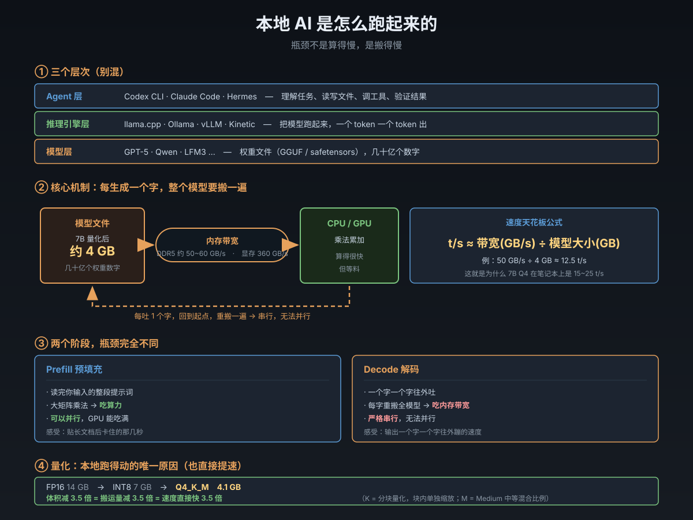

# 本地 AI 是怎么跑起来的

> 一句话：本地跑 AI 不是**算得慢**，是**搬得慢**——模型装在内存里，每吐一个字都要把它完整搬一遍。
> 来源：2026-11-10 与 Hermes 问答沉淀（数字世界底层常识系列第 5 篇）。触发点：看到 [Veloresearch/kinetic](https://github.com/Veloresearch/kinetic) 声称比 llama.cpp 快 4.5 倍，想搞清本地推理到底在干什么。

## 全景图



---

## 一、先分清三家：模型 / 引擎 / Agent

讨论本地 AI 最容易混的就是这三个层次。它们不在一个楼层：

```
┌─ 你             "帮我改这个函数"
│
├─ Agent 层       Codex CLI · Claude Code · Hermes    ← 理解任务、读写文件、调用工具、验证
│
├─ 推理引擎层     llama.cpp · Ollama · vLLM · Kinetic  ← 把模型跑起来，一个 token 一个 token 出
│
└─ 模型层         GPT-5 · Qwen · LFM3 ...              ← 权重文件（GGUF / safetensors）
```

| | 模型 | 推理引擎 | Agent |
|:--|:--|:--|:--|
| 是什么 | 一堆权重数字（静态文件） | 把权重跑起来的程序 | 用模型完成任务的程序 |
| 干什么 | 提供"知识" | 提供"速度" | 提供"手脚" |
| 例子 | Qwen3、LFM3、Llama | llama.cpp、Ollama、Kinetic | Codex、Hermes |
| 类比 | 发动机的零件图纸 | 发动机本体 | 整车 + 司机 |

**关键区分**：换一台效率高 5 倍的发动机，不等于这台车的运输效率高 5 倍——导航、装卸、等红灯（任务编排、试错、验证）不会因此变快。**Agent 慢的地方往往不在出 token，而在"想错了要重来"**。

---

## 二、模型文件里装的是什么

一个 7B 模型的"7B"= 70 亿个参数。每个参数就是一个浮点数。

**一个模型就是一个巨大的数字矩阵集合**，没有逻辑、没有规则、没有 if-else。所谓"推理"，就是拿这些矩阵做乘法。

### 体积换算（第一个必须记住的账）

| 精度 | 每参数字节 | 7B 模型大小 | 70B 模型大小 |
|:--|--:|--:|--:|
| FP32（32 位浮点） | 4 | 28 GB | 280 GB |
| FP16 / BF16（16 位） | 2 | **14 GB** | 140 GB |
| INT8（8 位整数） | 1 | 7 GB | 70 GB |
| **INT4（4 位）** | **0.5** | **约 4 GB** | 约 40 GB |

**结论**：不量化的话，7B 模型要 14GB 内存，70B 要 140GB——普通电脑根本装不下。**本地能跑 AI，唯一的原因是量化。**

### GGUF 是什么

GGUF 是 llama.cpp 定义的一种模型文件格式。它一个文件里装了三样东西：

| 内容 | 作用 |
|:--|:--|
| 元数据（metadata） | 模型架构参数、层数、维度、量化方式 |
| 权重（tensors） | 那几十亿个数字本体 |
| 分词器（tokenizer） | 文本 ↔ token 的转换表 |

**好处**：单文件、自描述、可以内存映射（mmap）直接加载，不用先解压到内存。这是 llama.cpp 生态的通行标准，Ollama、Kinetic 都读它。

---

## 三、量化：本地跑得动的唯一原因

量化的本质：**把每个参数的位数减少**，用精度换体积。

### 后缀怎么读

你会看到 `Q4_K_M`、`Q5_K_S`、`Q8_0` 这类名字，拆开看：

```
Q  4  _  K  _  M
│  │     │     └── M = Medium（中等混合比例，平衡档）
│  │     └──────── K = K-quant（分块量化，块内单独缩放，精度更高）
│  └────────────── 4 = 每个参数约 4 位
└───────────────── Q = Quantized（量化）
```

| 后缀 | 大致大小（7B） | 质量 | 什么时候用 |
|:--|--:|:--|:--|
| `Q8_0` | 约 7.5 GB | 几乎无损 | 内存充足、要最高质量 |
| `Q6_K` | 约 5.8 GB | 很好 | 追求质量 |
| **`Q5_K_M`** | **约 5.0 GB** | 好 | 质量优先的平衡点 |
| **`Q4_K_M`** | **约 4.1 GB** | **可接受** | **绝大多数场景的默认选择** |
| `Q4_0` | 约 3.8 GB | 一般 | 极省内存 |
| `Q3_K_M` | 约 3.3 GB | 明显下降 | 应急 |
| `Q2_K` | 约 2.6 GB | 明显变傻 | 不推荐 |

### 为什么量化能提速（不只是省内存）

这是第二个反直觉点：**量化提速不是间接效果，是直接效果。**

因为瓶颈是内存带宽（见第五节），模型文件小 3.5 倍 → 每次要搬的数据少 3.5 倍 → **速度直接快 3.5 倍**。

> 7B FP16 每秒搬 14GB 才能出 1 个字；Q4 只要搬 4GB。**同样的管道，流量相同，但每次要过的货少了。**

---

## 四、推理的两个阶段（瓶颈完全不同）

这是理解一切性能数字的钥匙。**模型出字不是"一次算完"，而是分成两个性质完全不同的阶段。**

| 阶段 | 干什么 | 瓶颈 | 能并行吗 | 什么时候感受到 |
|:--|:--|:--|:--|:--|
| **Prefill**（预填充） | 读完你输入的整段提示词，算好并缓存所有中间结果 | **算力**（大矩阵乘法） | ✅ 能，GPU 可以吃满 | **你贴长文档时卡的那几秒** |
| **Decode**（解码） | 一个字一个字往外吐 | **内存带宽**（严格串行） | ❌ 不能，必须等上一个 | **输出速度慢** |

**为什么 decode 不能并行**：每生成一个字，要把它拼回输入再算下一个字。字与字之间有严格依赖，天生串行。

### 这个区分解释了很多现象

| 现象 | 原因 |
|:--|:--|
| 贴 2 万字文档问问题，卡很久 | prefill 吃算力，输入太长 |
| 提示词很短但输出慢 | decode 吃带宽，和输入长度无关 |
| GPU 对 prefill 提升巨大，对 decode 提升有限 | 算力好优化，带宽是物理天花板 |
| 有些引擎首 token 快，但吐字速度没变 | 只优化了 prefill |

---

## 五、核心公式：内存带宽决定速度上限

**这一节是整篇最重要的。记住一个公式就能预测任何机器跑任何模型的速度。**

### 为什么每个字都要搬一遍整个模型

生成一个 token 的流程：

```
当前文本 → 转成向量 → 乘过模型里每一个矩阵 → 得到"下一个字"的概率分布
→ 采样选一个 → 拼到文本后面 → 重复
```

**矩阵乘法的特性**：你想得到哪怕一个输出数字，也要把参与运算的**整个矩阵**读进计算单元。而模型的权重分布在每一层里，所以**每生成一个字，全部权重都要被读取一遍**。

### 公式

$$\text{理论最高 t/s} \approx \frac{\text{内存带宽 (GB/s)}}{\text{模型大小 (GB)}}$$

### 各类硬件的带宽

| 硬件 | 带宽 | 跑 Q4 的 7B（4.1GB）理论上限 |
|:--|--:|--:|
| 笔记本 DDR5 双通道 | 约 50~60 GB/s | 约 12~15 t/s |
| 桌面 DDR5 双通道（高频） | 约 80~90 GB/s | 约 20~22 t/s |
| Apple M2 Pro（统一内存） | 约 200 GB/s | 约 49 t/s |
| Apple M3 Max（统一内存） | 约 400 GB/s | 约 98 t/s |
| RTX 3060（显存） | 360 GB/s | 约 88 t/s |
| RTX 4090（显存） | 约 1008 GB/s | 约 246 t/s |

**实测对得上**：7B Q4 在普通笔记本上跑 15~25 t/s，和公式算出的 12~15 t/s 同量级（实测略高，因为部分层有缓存复用）。

> **这就是为什么 GPU 快**：不是它"算得快"，是它**显存带宽是系统内存的 6 倍以上**。它是一条更粗的管子。

### 三个直接推论

1. **模型减半，速度翻倍**（量化有效）
2. **换更粗的内存条能提速**（硬件有效）
3. **算力再强也突破不了这个上限**（除非改变算法本身）

---

## 六、KV Cache：为什么上下文越长越吃内存

模型处理每个 token 时，会算出中间结果（Key/Value 向量），存下来避免重复计算。这就是 **KV cache**。

**问题在于它随上下文线性增长**：

| 上下文长度 | KV cache 粗估（7B 模型，FP16） |
|:--|--:|
| 2,000 token | 约 0.25 GB |
| 8,000 token | 约 1 GB |
| 32,000 token | 约 4 GB |
| 128,000 token | 约 16 GB |

**这解释了两件事**：

- **长上下文很贵**：不是算得久，是内存被缓存吃掉，而且这些缓存也要反复搬运
- **显存不够时为什么选"部分层放 GPU"**：因为要留空间给 KV cache

---

## 七、推理引擎到底在优化什么

同样是 llama.cpp / Ollama / vLLM / Kinetic 跑同一个模型，速度能差几倍。它们做的事：

| 优化点 | 具体在干什么 | 收益 |
|:--|:--|:--|
| **加载** | 内存映射（mmap）、按需读取、预热 | 启动快，避免全量拷贝 |
| **切分** | 哪些层放 GPU、哪些留 CPU（显存不够时） | 能用上部分 GPU 加速 |
| **内存布局** | 让权重连续摆放、对齐、合并访问 | **最大提速空间在这里** |
| **KV cache 管理** | 分页分配、复用、淘汰 | 支持长上下文 |
| **批处理调度** | 多请求攒批，一次权重读取服务多个 token | 服务端吞吐倍增 |
| **计算图融合** | 合并操作，减少中间结果落地 | 减少搬运次数 |
| **量化内核** | 用 SIMD/GPU 指令直接算低精度 | 反量化开销降到接近 0 |

> **Kinetic 的立论就在这一层**：模型和硬件都没变，但"怎么搬、搬几次、按什么顺序搬"还有大量工程空间。Rust 在内存控制上精细、无 GC 停顿，确实有优势。

### 一个必须警惕的地方

**性能声明要看它优化的是哪个阶段。**

比如 "首 token 从 10.95s 降到 0.13s（84 倍）"——这在 prefill 上是**可信的**，因为 prefill 是算力密集型，并行优化空间巨大。

但 "GPU decode 从 229 t/s 到 1033 t/s（4.5 倍）"就需要打个问号：

```
RTX 3060 带宽 360GB/s ÷ LFM3 1.7B Q4 约 1.1GB ≈ 327 t/s 理论天花板
实测 llama.cpp 229 t/s（70% 效率，合理）
声称 1033 t/s —— 超出物理天花板 3 倍
```

**除非它用了超越"朴素逐字解码"的机制**（比如投机解码：小模型草稿 + 大模型批量验证，输出仍逐字一致），否则讲不通。**看到这类数字，先看有没有第三方复现。**

---

## 八、四个反直觉的结论

| # | 直觉 | 实际 |
|:--|:--|:--|
| 1 | GPU 快是因为算得快 | **GPU 快是因为显存带宽粗 6 倍**。算力通常不是瓶颈 |
| 2 | 量化是为了省内存 | 量化**直接提速**——文件小了，搬运量就小了，速度等比例上升 |
| 3 | 上下文长所以算得久 | **是内存被 KV cache 吃掉**，不是计算量大 |
| 4 | 模型越大越慢 | 慢的是"每字搬运量"。同精度下 70B 比 7B 慢约 10 倍，接近线性 |

---

## 九、怎么自己上手（最省事的路径）

不用装 Kinetic，先用 **Ollama**（成熟稳定，两分钟能跑起来）：

```sh
# 1. 装一个 1.7B 小模型（约 1GB）
ollama pull qwen3:1.7b

# 2. 跑起来
ollama run qwen3:1.7b
```

### 三个可以亲手验证原理的实验

| 实验 | 怎么做 | 验证什么 |
|:--|:--|:--|
| **同模型问两遍** | 同一个问题连问两次 | 第二次更快 → 权重已在内存热着，**瓶颈是搬运** |
| **换成更大模型** | `ollama pull qwen3:7b` 再跑同一问题 | 速度按体积反比下降 → **公式 t/s ≈ 带宽 ÷ 大小** |
| **贴长文档** | 先问短问题，再贴 1 万字问 | 首 token 延迟暴增但吐字速度不变 → **prefill vs decode 是两个瓶颈** |

**这三个实验做完，本地推理的原理你就真的通了，不是记住了。**

---

## 十、金句汇总

- 本地跑 AI 不是**算力不够**，是**数据搬运跟不上**。像一台印刷机本身很快，但每印一页都要把整台机器拆了重装——产能被搬运卡死。
- **GPU 快不是因为算得快，是因为管子粗。**
- **量化不是省内存，是直接提速**——因为瓶颈就是"每次要搬多少货"。
- Prefill 吃算力，Decode 吃带宽。**"输入慢"和"输出慢"是两回事。**
- 换发动机不等于换整车。**Agent 慢在"想错了要重来"，不在出 token。**
- 看到"快 5 倍"先问一句：**它优化的是 prefill 还是 decode？**

---

## 关联

- [[AI是怎么跑起来的]] —— 系列第 4 篇，讲 AI 的**产业全链条**（训练→模型→推理→Agent→治理）；本篇讲**一台机器上的工程机制**
- [[数据是怎么流通的]] · [[互联网是怎么跑起来的]] · [[开源与操作系统谱系]]（系列前篇）
- [[数字世界常识索引]]（簇入口）· [[知识库首页]]
- [[我的技术观：重演·排列·跨界]] —— 「搬运 vs 计算」是同一个结构在不同层的重演
